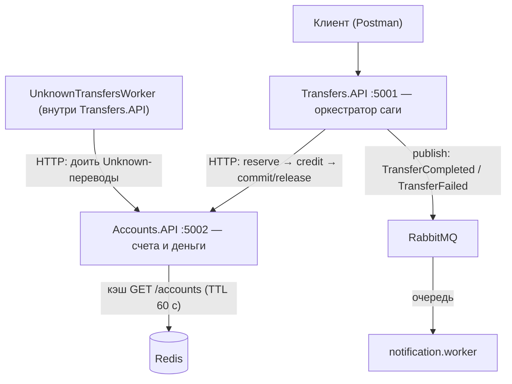

# NeoVault Lite

Проект: минимальный срез микросервисной архитектуры на .NET. Два сервиса с
собственными базами, HTTP-сага с компенсациями, события через RabbitMQ,
идемпотентность на нескольких уровнях, плюс playground-контуры на Kafka и Redis.

## Архитектура



## Проекты

| Проект | Порт | Роль |
|--------|------|------|
| **Accounts.API** | 5002 | Счета (balance + hold), сага-эндпоинты кассы, идемпотентные операции, Redis-кэш. БД: `accounts_db` |
| **Transfers.API** | 5001 | Переводы: оркестратор саги, publish событий, воркер реконсиляции. БД: `transfers_db` |
| **notification.worker** | — | Консюмер `TransferCompleted` / `TransferFailed`, печатает уведомления |
| **Contracts** | — | Общие контракты событий (`record`), на него ссылаются обе стороны |
| **Kafka.Producer / Kafka.Consumer** | — | Playground: журнал vs очередь (топик, offset, consumer groups) |

## Как работает перевод (orchestration)

1. `Transfer` пишется в базу со статусом `Pending` — ДО любых шагов.
2. **Reserve** (Accounts): `balance → hold` — замок на свои деньги.
3. **Credit** (Accounts): баланс получателя пополнен.
4. **Commit** (Accounts): `hold -= amount` — финализация, необратимый шаг последним.
5. Статус `Completed`, публикуется событие `TransferCompleted`.

Любой шаг упал → **Release** (компенсация: `hold → balance`) → статус `Failed`,
публикуется `TransferFailed`. Компенсация — не откат чужой системы, а своё
безопасное действие.

### Статусы и результат шага

Каждый HTTP-шаг возвращается как `StepResult { Ok, Refused, Unknown }`:
явный не-2xx — знаем, что шаг не случился (`Refused`), всё остальное — не знаем
(`Unknown`). Матрица саги:

| Шаг | Refused | Unknown |
|-----|---------|---------|
| reserve | → `Failed` | → `Unknown` |
| credit | → release + `Failed` | → `Unknown` (без release) |
| commit | → `Unknown` | → `Unknown` (экономически завершён — ретраить) |

Переводы в `Unknown` доит **UnknownTransfersWorker** (каждые 10 секунд): по
записям Operations в Accounts решает, какой шаг уже пробит, и доводит перевод до
`Completed` или `Failed`.

## Идемпотентность

Три этажа, каждый строит получатель:

- **Операции в Accounts**: ключ `transfer:{transferId}:{step}` — PK записи
  `Operation`; изменение счёта и запись чека — один `SaveChanges` (одна
  транзакция). Повторный вызов с тем же ключом работу не повторяет.
- **Клиентский дубль**: `PUT /transfers/{clientGuid}` — семантика PUT
  идемпотентна; повторный PUT с тем же Guid возвращает существующий перевод,
  деньги уезжают один раз. Одновременный дубль ловит PK.
- **Консюмер**: брокер даёт at-least-once — сообщение может прийти дважды,
  поэтому обработчик обязан переживать повтор.

## События (маленькая choreography)

После `SaveChanges` Transfers публикует контракт из **Contracts**:
`TransferCompleted` / `TransferFailed`. MassTransit матчит сообщения по полному
имени типа, поэтому namespace контрактов — ровно `Contracts`. Воркер просто
реагирует на события — издатель не знает читателей.

## Redis-кэш

`GET /accounts/{id}`: промах → база → запись в Redis с TTL 60 c; попадание →
ответ из кэша. Плата за скорость — минута возможной устаревшести (ловится руками
прямой правкой баланса в базе). Инвалидация при записи — в roadmap.

## Endpoints

**Accounts (:5002)** — параметры в query, числа invariant culture:

```
POST   /accounts/create-account
GET    /accounts
GET    /accounts/{id}
DELETE /accounts/delete-account?id={id}
POST   /accounts/reserve?id={id}&amount=100&transferId={guid}
POST   /accounts/credit?id={id}&amount=100&transferId={guid}
POST   /accounts/commit?id={id}&amount=100&transferId={guid}
POST   /accounts/release?id={id}&amount=100&transferId={guid}
GET    /operations/{key}          # 200 = операция выполнена, 404 = нет
```

`transferId` опционален: без него вызов работает как ручной, с ним — как шаг саги.

**Transfers (:5001)**:

```
POST /transfers?fromAccountId={guid}&toAccountId={guid}&amount=100
PUT  /transfers/{clientGuid}?fromAccountId={guid}&toAccountId={guid}&amount=100
GET  /transfers/{id}
```

PUT — идемпотентный способ создавать переводы (клиентский Guid).

## Запуск

Нужны: .NET 9 SDK, Docker Desktop.

```bash
git clone <repo-url>
cd NeoVaultLite

# 1. appsetting.json
Accounts: "ConnectionStrings": {
  "AccountsDb": "Host=localhost;Port=5433;Database=neovault;Username=neovault;Password=postgres"
}
Transfers: "ConnectionStrings": {
  "TransfersConnectionString": "Host=localhost;Port=5433;Database=transfersdb;Username=neovault;Password=postgres"
}


# 2. Инфраструктура: postgres, rabbitmq, kafka, redis
docker compose up -d

# 3. Строки подключения — в appsettings.json каждого проекта

# 4. Базы (миграции EF)
dotnet ef database update --project Accounts.API
dotnet ef database update --project Transfers.API

# 5. Три окна
dotnet run --project Accounts.API
dotnet run --project Transfers.API
dotnet run --project notification.worker
```

Проверка брокера: http://localhost:15672 (guest/guest) — exchanges
`Contracts:TransferCompleted` / `Contracts:TransferFailed`, очереди воркера.

## Инфраструктура (docker-compose)

| Сервис | Образ | Порты |
|--------|-------|-------|
| PostgreSQL | postgres:16 | 5433 (host) → 5432, базы `accounts_db` / `transfers_db` |
| RabbitMQ | rabbitmq:3-management | 5672 (AMQP), 15672 (UI) |
| Kafka | apache/kafka:3.7.0 (KRaft) | 9092 |
| Redis | redis:7 | 6379 |

## Осознанные упрощения

Нет валидации, пагинации, DTO-mapping, JWT, шлюза, тестов. Каждое отсутствие —
сознательный выбор учебного минимализма, а не недоделка.
